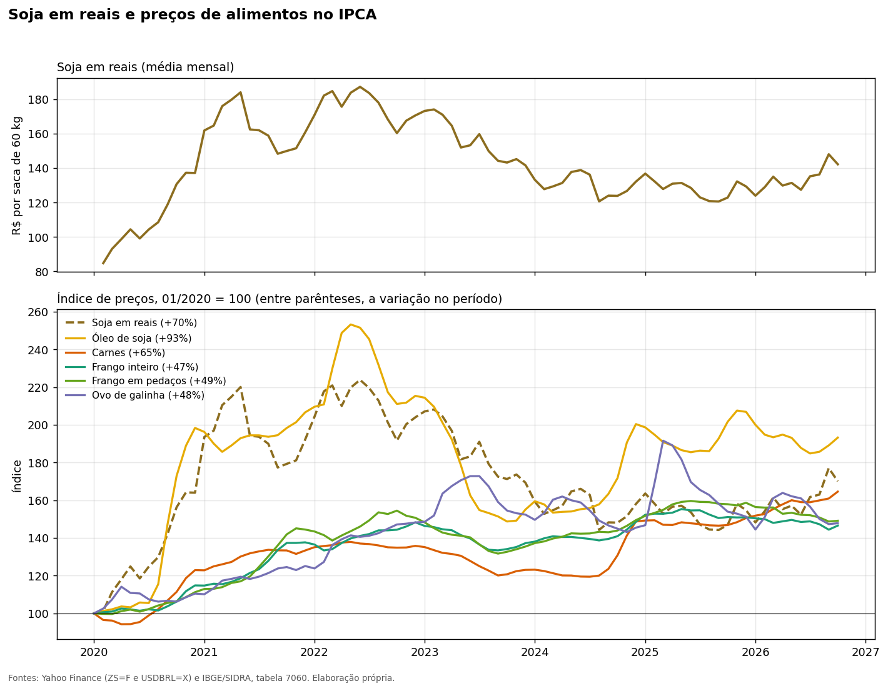
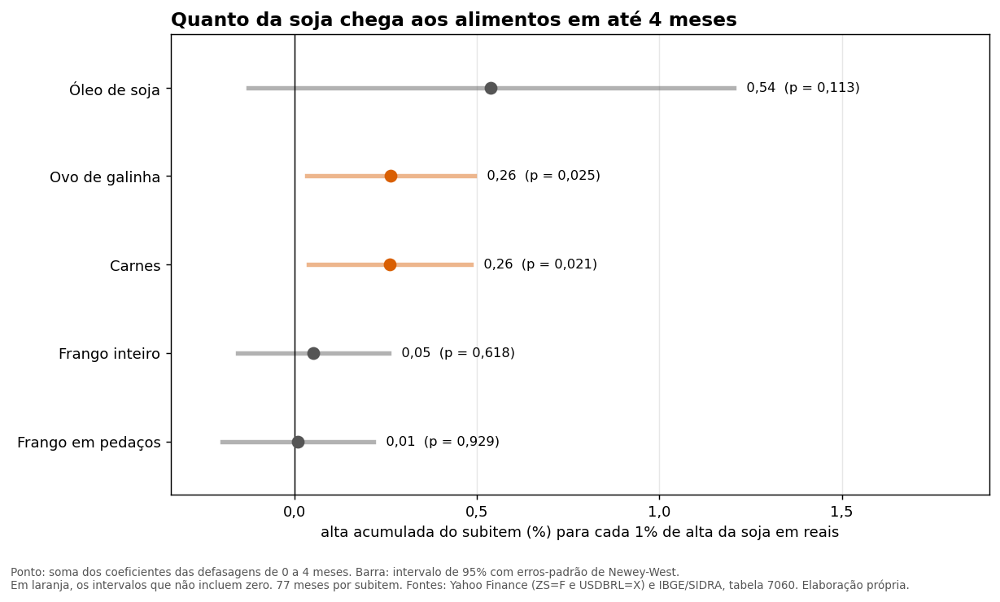
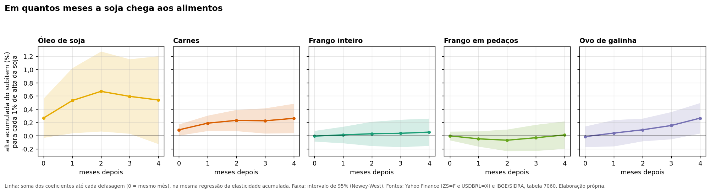
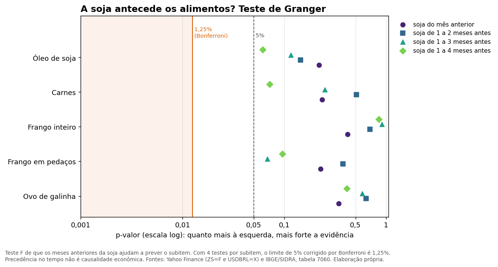

# Soja internacional × inflação de alimentos no Brasil

Este estudo mede quanto e com que defasagem a variação do preço da soja em reais chega aos preços de alimentos do IPCA, de janeiro de 2020 em diante. O pipeline roda no Databricks (PySpark, Delta Lake e Unity Catalog), e a análise usa statsmodels e MLflow.

A documentação completa, com todo o código e as decisões de metodologia, está em [projeto_soja_x_alimentos_databricks_e_pyspark.md](projeto_soja_x_alimentos_databricks_e_pyspark.md).

**Status:** os testes unitários passam localmente, e os três notebooks rodaram de ponta a ponta na Databricks Free Edition (serverless) em novembro de 2026, com dados de jan/2020 a out/2026.

## Pergunta e método

- **Soja em R$/saca de 60 kg:** o contrato contínuo da soja na CBOT (`ZS=F`, em centavos de dólar por bushel) vezes o dólar (`USDBRL=X`). A série usa a média mensal dos dias em que os dois mercados abriram.
- **Inflação de alimentos:** a variação mensal do IPCA (IBGE/SIDRA, tabela 7060) para óleo de soja, carnes, frango inteiro, frango em pedaços e ovo de galinha.
- **Medidas, para cada subitem:**
  - a elasticidade de repasse acumulada em até 4 meses, por uma regressão com defasagens de 0 a 4 meses e erros-padrão de Newey-West, com erro-padrão, p-valor e intervalo de 95% para a soma;
  - o teste de causalidade de Granger para cada defasagem de 1 a 4 meses, com o menor p-valor corrigido por Bonferroni.
- As duas séries entram como log-retorno mensal em %. Nenhuma variação ou defasagem é calculada atravessando um mês ausente.

## Pipeline

```text
yfinance (ZS=F, USDBRL=X) + IBGE SIDRA 7060
        │  01_bronze_ingestao (confere as respostas antes de gravar)
        ▼
Bronze   cotações diárias e variações mensais brutas
        │  02_silver_gold_transformacoes
        ▼
Silver   soja em R$/saca (média mensal) · IPCA por mês × subitem
        ▼
Gold     log-retornos + defasagens de 1 a 6 meses
        │  03_analise_mlflow
        ▼
MLflow   elasticidade, curva de repasse, R² ajustado, p-valores de Granger e gráficos por subitem
```

O Yahoo Finance às vezes responde sem erro, mas com uma tabela vazia ou com só parte do histórico. Por isso o notebook 01 tenta cada fonte até 3 vezes e confere a resposta antes de sobrescrever a Bronze: as cotações precisam cobrir de jan/2020 até a última semana, sem meses ralos, e o IPCA precisa trazer os 5 subitens, sem meses faltando, até no máximo 2 meses atrás. Se uma fonte continuar incompleta, o notebook falha e as tabelas ficam como estavam.

As tabelas ficam em `workspace.agro`, no Unity Catalog. Para usar outro catálogo ou schema, altere `CATALOG` e `SCHEMA` no início de cada notebook.

## Resultados (jan/2020 a out/2026)

Os gráficos saem do notebook 03 e também ficam guardados no run do MLflow, em **Artifacts → figuras**, junto com a tabela-resumo. Cada execução mensal do job grava uma versão nova no MLflow. As imagens deste README são as da execução de novembro de 2026.



De janeiro de 2020 a outubro de 2026, a soja em reais subiu 70%, com pico em meados de 2022. O óleo de soja acompanhou a soja de perto e subiu 93%. As carnes subiram 65%, e os frangos e o ovo, cerca de 48%.

| Subitem | Elasticidade em até 4 meses | IC de 95% | p-valor | Granger: menor p com Bonferroni |
|---|---:|---|---:|---:|
| Óleo de soja | 0,54 | −0,13 a 1,20 | 0,113 | 0,244 |
| Carnes | 0,26 | 0,04 a 0,48 | 0,021 | 0,285 |
| Ovo de galinha | 0,26 | 0,03 a 0,49 | 0,025 | 1,000 |
| Frango inteiro | 0,05 | −0,15 a 0,26 | 0,618 | 1,000 |
| Frango em pedaços | 0,01 | −0,20 a 0,22 | 0,929 | 0,271 |

São 77 meses por subitem, porque as 4 defasagens consomem os primeiros meses da série.



- **Carnes e ovo:** cada 1% de alta da soja em reais vem acompanhado, em até 4 meses, de uma alta de cerca de 0,26% no subitem, e o intervalo de 95% não inclui zero.
- **Óleo de soja:** tem a maior estimativa (0,54), mas o intervalo é largo e inclui zero.
- **Frangos:** a elasticidade não se distingue de zero.
- **Ressalva:** foram testados 5 subitens. Com a correção de Bonferroni para 5 testes (limite de 1%), nenhum p-valor seria significativo. Carnes e ovo são um indício, não uma prova.



- **Carnes:** o repasse começa no mesmo mês (0,09) e chega a 0,23 em 2 meses. Depois disso, quase não muda.
- **Óleo de soja:** é o repasse mais rápido e o maior. Chega a 0,53 em 1 mês e a 0,67 em 2 meses, com intervalos que não incluem zero entre 1 e 3 meses. No 4º mês a estimativa cai para 0,54, e o intervalo volta a incluir zero. Olhar vários horizontes também aumenta a chance de um deles excluir zero por acaso.
- **Ovo:** sobe aos poucos e só se distingue de zero no 4º mês.



Nenhum subitem passa no teste de Granger, nem sem correção: o menor p-valor é 0,061 (óleo de soja, com até 4 meses). Ou seja, os meses anteriores da soja não ajudam a prever o subitem além do que o próprio histórico do subitem já prevê.

A diferença entre os dois testes tem uma explicação provável. O Granger controla pelos meses anteriores do próprio subitem, e a regressão de repasse não. Então parte da associação medida no repasse pode ser a inércia do preço do alimento, ou choques que movem os dois juntos, como o dólar.

## Estrutura

```text
notebooks/              notebooks do Databricks, executados em ordem (01 → 02 → 03)
src/soja_alimentos/     conferência da ingestão (ingestao.py), transformações PySpark (transforms.py),
                        testes estatísticos (analise.py) e gráficos em Matplotlib (graficos.py)
reports/figuras/        gráficos da última execução, os mesmos do MLflow
tests/                  testes com pytest, que rodam localmente sem Databricks
requirements.txt        bibliotecas a instalar no cluster
requirements-dev.txt    ambiente local de testes
```

## Como rodar no Databricks

Requer Databricks Runtime 14 ou mais recente, porque os notebooks importam `src/` a partir da própria pasta.

1. Clone este repositório como Git folder no workspace (**Workspace → Create → Git folder**).
2. Os notebooks 01 e 03 instalam sozinhos, com `%pip`, as bibliotecas do `requirements.txt`: yfinance, requests, statsmodels e matplotlib. pyspark, pandas, numpy e mlflow já vêm no runtime.
3. Execute os notebooks em ordem: `01_bronze_ingestao`, `02_silver_gold_transformacoes` e `03_analise_mlflow`.

Os resultados ficam no experimento MLflow `/Shared/soja_alimentos_analise`: as métricas na aba **Metrics** e os gráficos e a tabela-resumo em **Artifacts → figuras**. A curva de repasse de cada subitem (`<subitem>_repasse_acumulado` e o intervalo de 95%) é registrada com a defasagem como `step`, de 0 a 4, e por isso aparece como gráfico no próprio run. O fim do notebook 03 também mostra a tabela e os gráficos.

## Como rodar os testes localmente

Requer Python 3.10 ou mais recente e Java 17.

```bash
python -m venv .venv
.venv/Scripts/python -m pip install -r requirements-dev.txt   # Windows
# .venv/bin/python -m pip install -r requirements-dev.txt     # Linux/macOS
.venv/Scripts/python -m pytest -v
```

O pytest roda 30 testes. Eles cobrem a conferência das respostas do Yahoo Finance e do SIDRA e as novas tentativas, a curva de repasse e o registro dela no MLflow, a geração dos gráficos, o log-retorno e as defasagens sem vazamento de dados, os meses ausentes, a limpeza de `NaN` e dos valores especiais do SIDRA, o erro-padrão da elasticidade acumulada e o teste de Granger, conferido contra o do statsmodels.

## Limitações

- `ZS=F` emenda contratos futuros sucessivos, e cada troca de contrato pode criar um salto artificial no preço.
- A soja em reais mistura o preço em Chicago com o câmbio, e o dólar também afeta os alimentos por outros caminhos. A elasticidade medida não separa os dois efeitos.
- O preço é o internacional convertido para reais, não o preço pago no Brasil (não inclui prêmio de porto nem frete).
- O teste de Granger indica precedência no tempo, não causalidade no sentido econômico.

## Fontes de dados

- [IBGE SIDRA, tabela 7060](https://sidra.ibge.gov.br/tabela/7060): IPCA, variação mensal por subitem, desde janeiro de 2020.
- Yahoo Finance, via [yfinance](https://github.com/ranaroussi/yfinance): `ZS=F` (soja na CBOT) e `USDBRL=X` (dólar). O uso dos dados segue os termos do Yahoo Finance.
